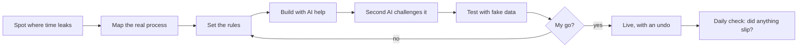

# Adam Wei

**Data Technician apprentice (Level 3) · Liverpool, UK · working towards Data Analyst**

I work on AI and automation for a small UK home-services company, alongside a Level 3 Data Technician apprenticeship with NowSkills. I look for places where work gets lost or slowed down, map how the process really flows, set the rules for a fix and test it before anything goes live.

## What's here, and what isn't

- ✅ **Real projects, written up honestly.** Each one says whether it's live or still in testing.
- ✅ **Fake data only.** No customer details, company names, internal links or keys are ever published. Every file passes my [upload safety check](https://github.com/adamwei2009-design/build-log/tree/main/tools) before it's pushed.
- ✅ **Honest about AI.** I design the process, set the rules, test it and decide what goes live. AI tools help me write code and challenge my work. I say which is which.
- ❌ I'm not selling anything, and I'll never ask you to download or pay for something.

## How I work

## Selected builds

| Build | Status | What it shows |
|---|---|---|
| [Enquiry auto-reply](https://github.com/adamwei2009-design/build-log/blob/main/builds/01-enquiry-auto-reply.md) | Live | Process design, routing rules, a daily "nothing slipped" check |
| [WhatsApp quote journey](https://github.com/adamwei2009-design/build-log/blob/main/builds/02-whatsapp-quote-journey.md) | Live | API integration; first reply cut from about 2m40s to 27s in testing |
| [Upload safety check](https://github.com/adamwei2009-design/build-log/tree/main/tools) | In use | Python: blocks secrets and personal data before anything goes public |

More are added as I write them up. Full list: [build-log](https://github.com/adamwei2009-design/build-log).

## Skills

**Using now:** Excel · Power Query · Google Sheets · Zapier · Cloudflare Workers · Process mapping (Lucidchart) · Claude and ChatGPT
**Learning:** SQL · Power BI · Python

## Learning

- Level 3 Data Technician apprenticeship (NowSkills), in progress
- Current focus: checking data before trusting it (row counts, raw-data checks, spotting the mistake), Power Query, SQL

📫 The best way to reach me is a message on [LinkedIn](https://www.linkedin.com/in/adam-wei-4407a13b8).
